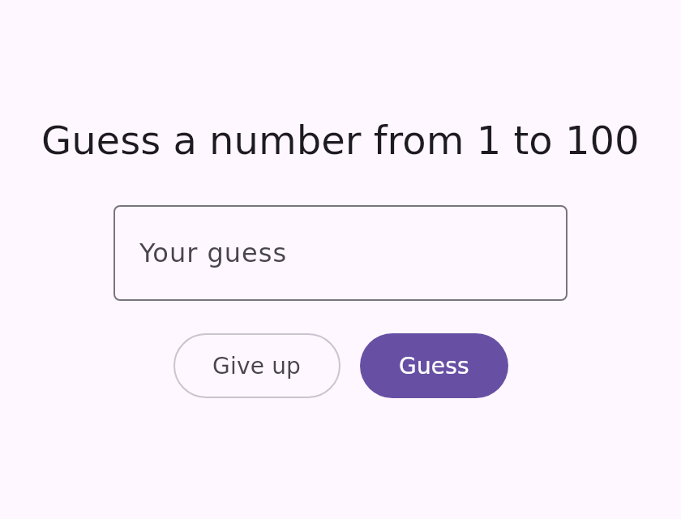
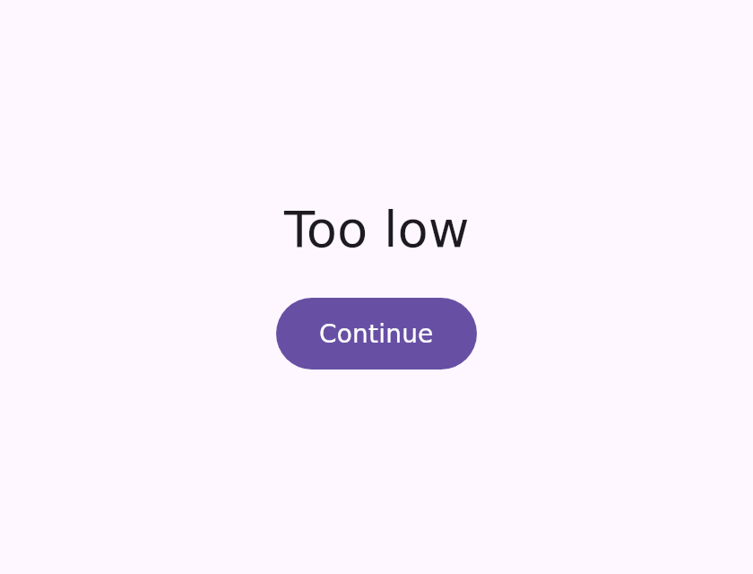

# Spike: the UI as the T-function's receiver (GuessGame)

Exploration, not product code. It tests option D from the "Alternatives to UI StateFlows" doc: drop
the per-node `UiStateFlow` projection and let one **UI host** receive every T-function's
`UiState(input, callback)` package. Builds against the real `com.genovich.components` 0.2.0.

```bash
./gradlew :core:test :compose:test   # scripted, bot and screenshot tests
./gradlew :core:run -q               # play in the console
./gradlew :compose:run               # play in a Compose Desktop window
```

## How it works

1. **Logic is unchanged** (`core/.../GuessGame.kt`). Four ports, all plain `Action`s. Each round
   runs `askGuess` and `giveUp` in `parallel`, then `showResult`.
2. **The assembly binds T-function ports to the host** (`GuessGameAssembly`):
   `askGuess = host.show(GuessGamePorts.askGuess)`. `host.show` is the library's own `Show`, so the
   send → wait → resume handshake is untouched.
3. **The host keeps the set of waiting requests** (`uihost/UiHost.kt`). `Show` sends a `UiState` →
   the host adds a `Request(port, state)`; the callback or a cancellation sends `null` → the host
   removes it. That set (`host.live`) is the only thing a UI observes. There is no projection.
4. **A generated `GuessGameScreens<R>` interface** says which screens exist, one method per screen,
   with the waiting requests as parameters. `askGuess` and `giveUp` are `parallel` siblings, so
   they are one screen (`guessing`); `showResult` is its own (`result`). A generated `render(live)`
   picks the screen whose ports are all waiting.
5. **Any client implements the interface.** `R` is whatever that client draws with:

| Client | `R` | File |
| --- | --- | --- |
| Compose Desktop | `@Composable () -> Unit` | `compose/.../ComposeScreens.kt` |
| Console | `Prompt(text, onLine)` | `core/.../cli/Main.kt` |
| Binary-search bot | `() -> Unit` | `core/src/test/.../BotClientTest.kt` |
| Scripted test | none: answers `host.awaitRequest(port)` directly | `GuessGameHostTest.kt` |

A user tap is just `request.answer(value)`, which resumes the suspended `Action` in the logic.

## What it replaces

Today visual-ide generates `GuessGameUiStateFlow`: one `MutableStateFlow` per T-function, a sealed
`Screen`, and `combine(emitSelfWhenHaveValue(...))`. Here the generated part is
`core/.../GuessGameScreens.kt`: ports, the screens interface, `render`, and the assembly. None of it
mentions flows, and none of it is per-node merge logic; the merge rule lives once in the host.

## Screens (rendered headlessly by `ScreenshotTest`)

| Guessing (`askGuess` + `giveUp`) | Result (`showResult`) | After "Give up" |
| --- | --- | --- |
|  |  |  |

## Limitations found

- **Requests are keyed by port.** Two live calls of the same port (a list of items, a feature
  opened twice) would collide. Needs the call-site path in the key, the same key the state
  restoration brainstorm wants.
- **Brief gaps between screens.** After a guess is answered, `giveUp` is still waiting for a moment
  before `parallel` cancels it, so no screen matches; clients keep the last screen (`mapNotNull`
  in Compose). Same issue as today's `collectLastNonNull`, handled once in the client root.
- **Scopes and Back are not in this spike.** GuessGame has no on-demand feature; JetNews is the
  test for "a scope covers its siblings" and Back-to-close.
- **Grouping is hand-written here** as the would-be generated output. visual-ide would derive it
  from the diagram (parallel siblings → one screen).
