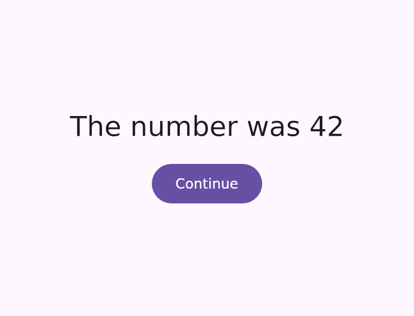
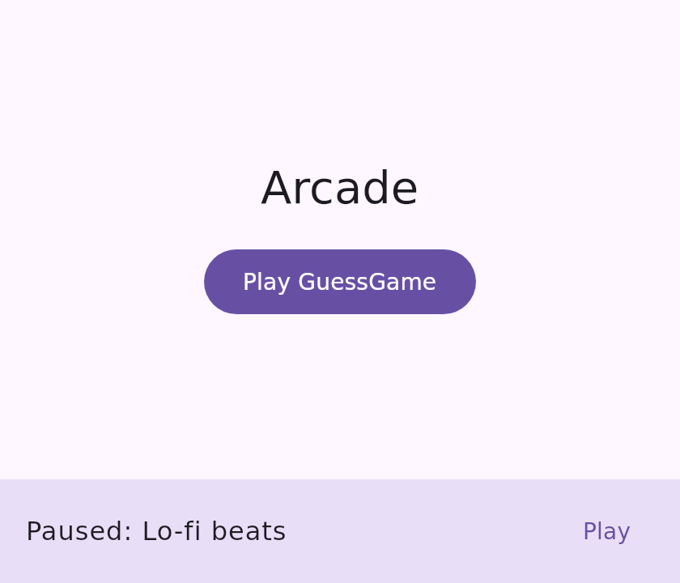
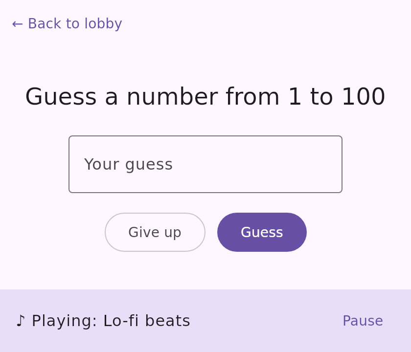
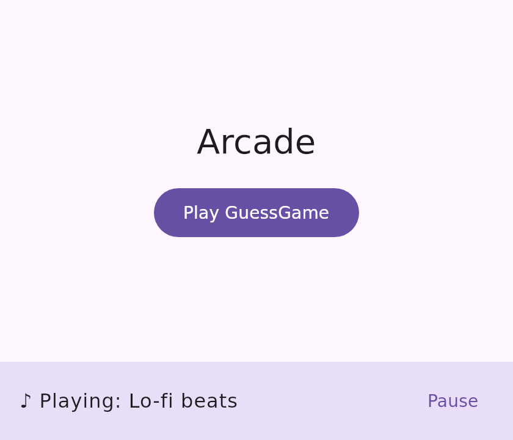

# Spike: the UI as the T-function's receiver (GuessGame)

Exploration, not product code. It tests option D from the "Alternatives to UI StateFlows" doc: drop
the per-node `UiStateFlow` projection and let one **UI host** receive every T-function's
`UiState(input, callback)` package. Builds against the real `com.genovich.components` 0.2.0.

```bash
./gradlew :core:test :compose:test   # scripted, bot and screenshot tests
./gradlew :core:run -q               # play in the console
./gradlew :compose:run               # play in a Compose Desktop window
```

## How it works

1. **Logic is unchanged** (`core/.../GuessGame.kt`). Four ports, all plain `Action`s. Each round
   runs `askGuess` and `giveUp` in `parallel`, then `showResult`.
2. **The assembly binds T-function ports to the host** (`GuessGameAssembly`):
   `askGuess = host.show(GuessGamePorts.askGuess)`. `host.show` is the library's own `Show`, so the
   send → wait → resume handshake is untouched.
3. **The host keeps the set of waiting requests** (`uihost/UiHost.kt`). `Show` sends a `UiState` →
   the host adds a `Request(port, state)`; the callback or a cancellation sends `null` → the host
   removes it. That set (`host.live`) is the only thing a UI observes. There is no projection.
4. **A generated `GuessGameScreens<R>` interface** says which screens exist, one method per screen,
   with the waiting requests as parameters. `askGuess` and `giveUp` are `parallel` siblings, so
   they are one screen (`guessing`); `showResult` is its own (`result`). A generated `render(live)`
   picks the screen whose ports are all waiting.
5. **Any client implements the interface.** `R` is whatever that client draws with:

| Client | `R` | File |
| --- | --- | --- |
| Compose Desktop | `@Composable () -> Unit` | `compose/.../ComposeScreens.kt` |
| Console | `Prompt(text, onLine)` | `core/.../cli/Main.kt` |
| Binary-search bot | `() -> Unit` | `core/src/test/.../BotClientTest.kt` |
| Scripted test | none: answers `host.awaitRequest(port)` directly | `GuessGameHostTest.kt` |

A user tap is just `request.answer(value)`, which resumes the suspended `Action` in the logic.

## What it replaces

Today visual-ide generates `GuessGameUiStateFlow`: one `MutableStateFlow` per T-function, a sealed
`Screen`, and `combine(emitSelfWhenHaveValue(...))`. Here the generated part is
`core/.../GuessGameScreens.kt`: ports, the screens interface, `render`, and the assembly. None of it
mentions flows, and none of it is per-node merge logic; the merge rule lives once in the host.

## Screens (rendered headlessly by `ScreenshotTest`)

| Guessing (`askGuess` + `giveUp`) | Result (`showResult`) | After "Give up" |
| --- | --- | --- |
|  |  |  |

## Limitations found

- **Requests are keyed by port within one host.** Nested scopes (below) separate features; a list
  of items would still need one child scope per item key.
- **Brief gaps between screens.** After a guess is answered, `giveUp` is still waiting for a moment
  before `parallel` cancels it, so no screen matches; clients keep the last screen (`mapNotNull`
  in Compose). Same issue as today's `collectLastNonNull`, handled once in the client root.
- **The Compose root redraws from the top on any change** (new lambdas every time). Fine at this
  size; a real client would render per scope so unchanged scopes skip.
- **Grouping is hand-written here** as the would-be generated output. visual-ide would derive it
  from the diagram (parallel siblings → one screen).

## Nested scopes with typed keys (`arcade/`, `player/`)

The host is now a tree: one `UiHost` per scope. `UiHost.scope(key) { child -> ... }` attaches a child
for exactly as long as the feature runs. Only scope operators open children:
`onDemandFeature(host, open, close, key) { child -> ... }` and `scoped(host, key) { child -> ... }`.

The example is a small root, **Arcade**: a lobby that opens **GuessGame** as an on-demand feature
(placement `Cover`), and a **Player** mini-bar running in parallel the whole time (placement
`Beside`). Neither the Arcade, GuessGame nor Player logic knows about hosts.

```text
arcade host        openGame | closeGame
├─ guessGame host  askGuess, giveUp | showResult      (Cover: exists only while the game is open)
└─ player host     toggle                               (Beside: always there)
```

How a child scope gets its screens, **typed keys**:

- Each feature generates a `ScopeKey` next to its screens interface (`GuessGameScope`, `PlayerScope`)
  plus a typed `Screens<R>.register(key, impl: XScreens<R>)`.
- The client registers every scope's screens once:
  `register(ArcadeScope, ArcadeComposeScreens); register(GuessGameScope, ComposeScreens); ...`.
  A dynamically loaded feature would register its own when it arrives.
- The parent's generated dispatch only names the child's **key**. It gets the child already drawn as
  `R`: `game(game: R, closeGame, player: R?)`. Arcade never mentions `GuessGameScreens`.
- The only runtime failure is a missing registration, reported by scope name
  (`No screens registered for scope 'arcade'`).

Placement:

- `Cover` (GuessGame): the parent has a screen method that replaces its siblings. `root.back()`
  answers the close request of the deepest open `Cover` scope; in the desktop app, Escape calls it.
- `Beside` (Player): an optional `player: R?` slot in every parent screen it can sit next to.
  Back skips it, so with only the lobby and player open, `back()` returns `false` (platform handles it).

| Lobby + player | Game open, player playing | After Back |
| --- | --- | --- |
|  |  |  |

Tests: `core/src/test/kotlin/arcade/ArcadeHostTest.kt` (text client: covering, beside, Back, fresh
scope on reopen, missing registration). `./gradlew :compose:run` now starts the Arcade.
